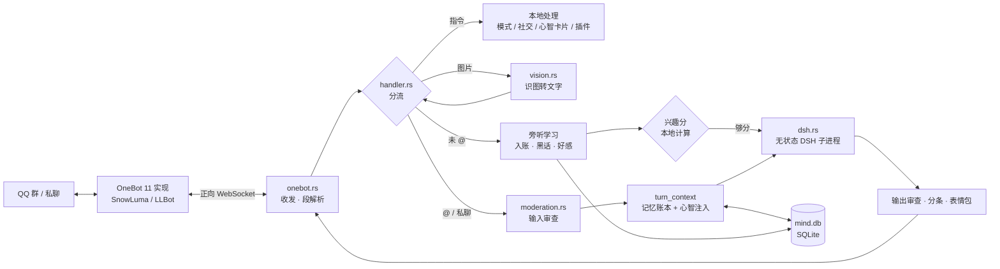
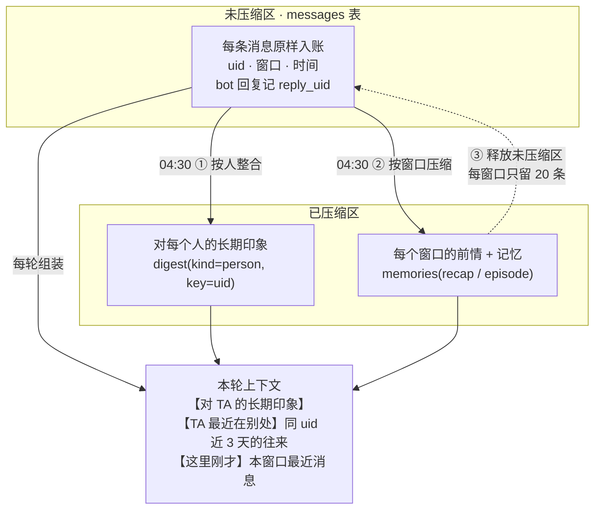
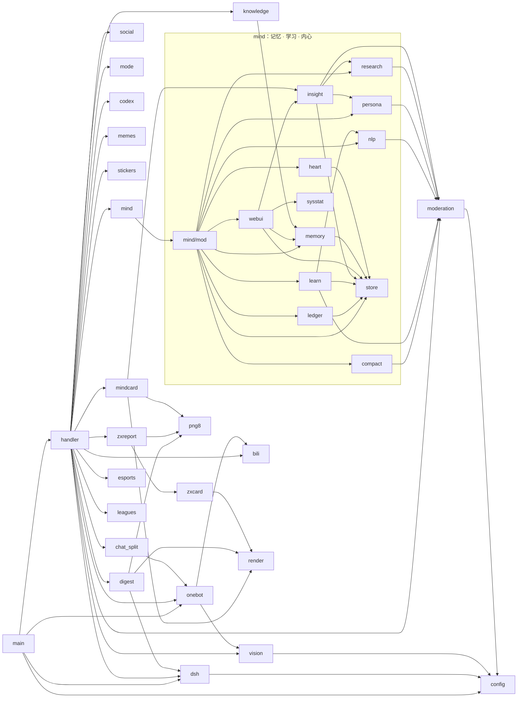

# HeeviBot

一个有记忆、会学习、有自己脾气的 QQ 群聊机器人。Rust 编写，单进程。QQ 侧走 **OneBot 11**（SnowLuma / LLBot 等），
思考交给 **DeepSeek Harness（DSH）** 的 headless 模式（可带联网搜索、天气、B 站等工具），记忆全部存在本地 SQLite。

> 这是 HeeviBot 的第二代（Rust 重写）。第一代基于 NoneBot2（Python）的版本保留在分支
> [`legacy-nonebot`](../../tree/legacy-nonebot)。

- **跨窗口记忆**：同一个 QQ 号在 A 群说过的事，到 B 群、私聊里她都接得上；私聊里的事在群里不说破。
- **两层记忆**：白天原样入账（未压缩区），夜里整合进长期印象与前情（已压缩区），再释放原始记录。
- **无状态调用、token 有上限**：每轮上下文从本地库现场组装（实测约 3.6k 输入 token），不续越聊越长的模型会话。
- **自我学习**：表达风格、群黑话、多面人物画像、好感度；对不懂的词按「是什么 → 为什么 → 怎么做」夜间自学，防营销号与投毒。
- **主动性**：本地算「兴趣分」决定要不要插话（0 token）、按好感主动私聊、自己审批入群 / 好友、在待不下去的群里先问主人再退群。
- **内容审查**：擦边 / 色情 / 政治言论拒绝，摸头、贴贴这类普通亲昵不误伤；冒犯会降好感。
- **插件**：识图、表情差分贴纸、meme 梗图、群聊日报卡片、早报卡片、B 站解析、CS2 / VLR / LOL 战报、本地攻略知识库、Codex 额度查看。
- **心智 WebUI**：本机 `http://127.0.0.1:8090`，看记忆、画像、认知曲线，能在后台纠错。

## 架构

### 一条消息的路径



### 记忆账本（`src/mind/ledger.rs`）



- **窗口** = 一个群或一个私聊（会话键 `qq-group-<群号>#<世代>` / `qq-c2c-<QQ号>#<世代>`）；「重置记忆」= 世代 +1 开新窗口。
- **跨窗口**：别人的话不跨窗口，只带当前说话人自己的往来；在群里时私聊内容标「私下」、不说破。
- **token**：旧方案续 DSH 长会话，每轮中位 2.6 万、P90 8.7 万输入 token；账本方案每轮约 3.6k（其中 2.7k 命中缓存），且不随聊天变长。

### 代码图谱

模块依赖（箭头 = 调用，由 `use crate::…` / `crate::x::` 引用统计）：



| 模块 | 行数¹ | 测试 | 职责 |
|---|---:|---:|---|
| `handler` | 3172 | 20 | 事件分流、指令、插话决策、回复管道、夜间整理调度 |
| `mind/store` | 1168 | — | SQLite 存储层：消息、记忆、画像、好感、好奇心、摘要 |
| `zxreport` · `zxcard` | 778 · 404 | 5 | 早报：数据抓取、卡片排版、定时推送 |
| `mind/mod` | 739 | 16 | 心智入口：入账、学习、召回、注入组装 |
| `onebot` | 589 | 10 | OneBot 11 WebSocket 客户端、消息段解析、发送 |
| `render` · `png8` | 554 · 103 | 5 | 日报卡片绘制（fontdue）、索引色 PNG 压缩 |
| `vision` | 520 | 11 | 多模态识图（OpenAI / Anthropic 协议，主备切换） |
| `digest` | 518 | 8 | 群聊日报：采集、AI 汇总、出图 |
| `mind/webui` + `dashboard.html` | 441 | 1 | 内嵌 axum 后台（ASCII 极客风） |
| `codex` | 410 | 5 | 通过 `codex app-server` 查 Codex 额度与任务进度 |
| `memes` | 410 | 5 | 对接 meme-generator 做梗图 |
| `mind/insight` · `mindcard` | 410 · 309 | 4 | 认知曲线 / 画像置信度视图；QQ 里出卡片、纠错 |
| `esports` · `leagues` | 405 · 265 | 5 | Liquipedia CS2、VLR.gg、lolesports 数据与订阅战报 |
| `mind/nlp` | 398 | 4 | jieba 分词 + 词性：黑话候选、定义挖掘、事实抽取 |
| `config` | 394 | — | 全部配置走环境变量 / `.env` |
| `moderation` | 391 | 11 | 关键词 + 审核模型的输入输出审查、亲昵与骚扰区分 |
| `dsh` | 366 | 7 | DSH 子进程桥：stdin 输入、JSON 事件解析、用量统计 |
| `knowledge` | 360 | 4 | 本地攻略库：按标题切块、BM25 检索注入 |
| `bili` | 325 | 3 | B 站链接 / 小程序卡片解析 |
| `stickers` | 309 | 7 | 表情差分贴纸库：按情绪挑图、冷却与上限 |
| `mind/compact` | 297 | 6 | 夜间压缩：挑材料、写前情与记忆、画像与好奇心 |
| `mind/learn` | 288 | 9 | 表达风格、黑话、好感度算法 |
| `social` | 256 | 6 | 入群 / 好友审批、主动私聊、退群护栏 |
| `mind/research` | 242 | 4 | 夜间自学三阶段、来源可信度、防投毒校验 |
| `mind/ledger` | 228 | 4 | 记忆账本：跨窗口上下文、人物印象整合、释放未压缩区 |
| `chat_split` | 219 | 9 | 拟人化分条发送 |
| `mind/persona` | 166 | 3 | 多面人物画像与置信度曲线 |
| `mode` | 152 | 3 | 正常 / 节能 / 静默 运行模式 |
| `mind/memory` · `heart` · `sysstat` | 127 · 106 · 112 | 4 | BM25 召回、精力系统、进程指标 |

¹ 不含测试代码。合计约 1.6 万行、180 个测试（其中十几个需要本机 DSH / 网络，默认忽略）。

## 仓库里有什么、没什么

| 进仓库（代码） | 只留本地 |
|---|---|
| `src/`、`Cargo.toml`、`Cargo.lock` | `.env`（密钥、主人 QQ 号、人设提示词） |
| `.env.example`（全部配置项与说明） | `mind_data/`（记忆库、资料库、表情包、早报素材） |
| `tools/docx_to_md.py` | `logs/`（日志、日报、审查记录） |
| `meme_server/` 的启动与字体脚本 | 人设文件（如 `~/.dsh/persona/*.md`、DSH profile） |
| | 人设图 / 贴纸生成脚本、调试脚本、备份 |

`.gitignore` 是白名单：默认全部忽略，只放行左列。

## 快速开始

**需要**：Windows（其它平台未测）、Rust stable、DeepSeek Harness、一个 OneBot 11 实现（如 SnowLuma）。
可选：多模态模型的 API key（识图 / 审查）、[meme-generator](https://github.com/MemeCrafters/meme-generator)。

1. **OneBot**：给机器人账号开一个正向 WebSocket（`wsServers`，role `Universal`，messageFormat `array`），
   端口用 15001 以上（例如 23211）。
2. **DSH**：建一个 profile（例如 `qqbot`）配好聊天模型；确认 `dsh --profile qqbot --json "只回复：收到"` 能输出 `{"type":"final",…}`。
3. **配置**：`copy .env.example .env`，至少填 `ONEBOT_WS_URL`、`ONEBOT_ACCESS_TOKEN`、`DSH_PROFILE`、`QQ_BOT_SUPERUSERS`；
   人设写进 `QQ_BOT_SYSTEM_PROMPT`，或用 `QQ_BOT_SYSTEM_PROMPT_FILE` 指向本地文件。
4. **运行**：

   ```bash
   cargo build --release
   ```
   ```bash
   target\release\qqbot-hermes.exe
   ```

   日志出现「OneBot 已就绪」「心智 WebUI 已启动」即可，数据目录 `mind_data/` 会自动创建。
5. **可选 · 梗图**：在 `meme_server/` 建 venv 装 `meme-generator`，运行 `fetch_fonts.py` 下字体，`start.bat` 启动（默认 3233 端口）。
6. **可选 · 知识库**：把攻略文档放进 `mind_data/knowledge/`（Word 先用 `tools/docx_to_md.py` 转成 Markdown）。

## QQ 里怎么用

群里 @ 她或私聊直接聊。常用指令（发「help」看全部）：

| 指令 | 说明 |
|---|---|
| `help` / `帮助 <模块>` | 指令总览 |
| `重置记忆` | 开一个新的会话窗口（群主 / 管理员 / 超级用户） |
| `模式` / `模式 节能` | 查看 / 切换运行模式（超级用户） |
| `我的画像` · `画像 <QQ号>` | 她眼中的你（卡片）· 主人私聊查别人 |
| `你对 X 了解多少` · `纠正 X：…` | 她对某件事的理解与认知曲线 · 纠错（主人直接生效，其他人当线索再查证） |
| `群列表` · `待审批` · `退群 <群号>` · `留下 <群号>` | 社交管理（超级用户） |
| `codex额度` · `codex进度` | Codex 实时额度与任务进度（超级用户） |
| `早报订阅` · `cs订阅战队 <队名>` · `vlr赛程 <队名>` · `lol订阅 <队名>` | 插件订阅与查询 |
| `摸 @某人` · `表情列表` | 梗图 |
| `别私聊我` | 以后她不再主动找你 |

## 开发

```bash
cargo test
```

需要本机 DSH / 网络的实机演练默认忽略，例如跨窗口记忆演练：

```bash
cargo test ledger_live -- --ignored --nocapture
```

## 第三方项目

### 运行时依赖的外部项目

| 项目 | 用途 | 仓库 |
|---|---|---|
| DeepSeek Harness | 思考与工具调用（headless 子进程） | https://github.com/deepseek-ai/deepseek-harness |
| SnowLuma | OneBot 11 实现，连接 QQ | https://github.com/SnowLuma/SnowLuma |
| LuckyLilliaBot（LLBot） | 另一种 OneBot 11 实现，可替代 SnowLuma | https://github.com/LLOneBot/LuckyLilliaBot |
| OneBot 11 | 协议标准 | https://github.com/botuniverse/onebot-11 |
| meme-generator | 梗图生成服务（`meme_server/`，字体也取自该仓库） | https://github.com/MemeCrafters/meme-generator |
| Codex | `codex app-server` 查额度与任务进度 | https://github.com/openai/codex |

### Rust 依赖（`Cargo.toml` 直接依赖）

| crate | 版本 | 用途 | 仓库 | 许可 |
|---|---|---|---|---|
| tokio | 1.53 | 异步运行时 | https://github.com/tokio-rs/tokio | MIT |
| tokio-tungstenite | 0.20 | OneBot WebSocket 客户端 | https://github.com/snapview/tokio-tungstenite | MIT |
| futures-util | 0.3 | 流 / Future 工具 | https://github.com/rust-lang/futures-rs | MIT / Apache-2.0 |
| axum | 0.7 | 心智 WebUI | https://github.com/tokio-rs/axum | MIT |
| reqwest | 0.12 | HTTP 客户端（视觉模型、数据源） | https://github.com/seanmonstar/reqwest | MIT / Apache-2.0 |
| rusqlite | 0.31 | SQLite 记忆库（bundled，内置 SQLite） | https://github.com/rusqlite/rusqlite | MIT |
| jieba-rs | 0.7 | 中文分词与词性 | https://github.com/messense/jieba-rs | MIT |
| serde / serde_json | 1 | 序列化 | https://github.com/serde-rs/serde · https://github.com/serde-rs/json | MIT / Apache-2.0 |
| regex | 1 | 正则 | https://github.com/rust-lang/regex | MIT / Apache-2.0 |
| image | 0.25 | 图片处理 | https://github.com/image-rs/image | MIT / Apache-2.0 |
| png | 0.18 | 索引色 PNG 编码 | https://github.com/image-rs/image-png | MIT / Apache-2.0 |
| fontdue | 0.9 | 卡片文字栅格化 | https://github.com/mooman219/fontdue | MIT / Apache-2.0 / Zlib |
| chrono | 0.4 | 日期时间 | https://github.com/chronotope/chrono | MIT / Apache-2.0 |
| tracing / tracing-subscriber / tracing-appender | 0.1 / 0.3 / 0.2 | 日志 | https://github.com/tokio-rs/tracing | MIT |
| sysinfo | 0.39 | 进程指标 | https://github.com/GuillaumeGomez/sysinfo | MIT |
| anyhow | 1 | 错误处理 | https://github.com/dtolnay/anyhow | MIT / Apache-2.0 |
| dotenvy | 0.15 | 读取 `.env` | https://github.com/allan2/dotenvy | MIT |

间接依赖见 `Cargo.lock`。数据来源（非 git 仓库）：Liquipedia（CS2）、VLR.gg、lolesports、B 站公开接口。

## 许可

暂未指定许可证；如需使用或二次分发请先联系作者。
